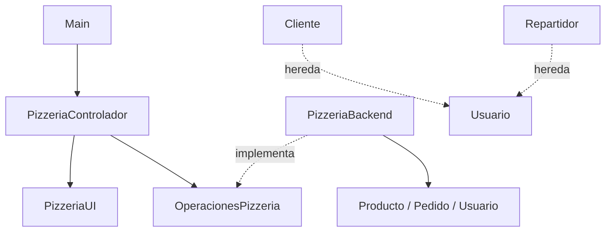

# Pizzería – Semana 2

App de consola en Kotlin para gestionar pedidos, clientes, inventario y repartidores.
Separa la lógica de negocio (backend), la interfaz de consola (UI) y el flujo (controlador) mediante una interfaz.

## Cómo ejecutarla

Se necesitan Java y el compilador de Kotlin (`java` y `kotlinc` disponibles en la terminal). No usa Gradle ni librerías externas.

**PowerShell** (desde esta carpeta):

    kotlinc (Get-ChildItem src -File -Filter *.kt).FullName -include-runtime -d Main.jar
    if ($LASTEXITCODE -eq 0) { java -jar Main.jar }

**Bash:**

    kotlinc src/*.kt -include-runtime -d Main.jar && java -jar Main.jar

**Sin compilar:** se incluye `Main.jar` ya compilado: `java -jar Main.jar`

**IntelliJ IDEA:** abrir esta carpeta, abrir `src/Main.kt` y presionar el botón verde junto a `fun main()`.

## Menú
1. Registrar nuevo pedido (cotiza, muestra el resumen, pide confirmación y recién descuenta ingredientes y asigna repartidor)
2. Ver reporte del día (completados / pendientes)
3. Avanzar estado de un pedido (En preparación → Listo → En camino)
4. Ver inventario
5. Reabastecer ingrediente
6. Ver estadísticas de ventas
7. Ver clientes y repartidores
8. Ejecutar pruebas de casos límite

## Reglas de negocio
- Descuento del 10% si el pedido tiene más de 3 pizzas.
- IVA 19% sobre (subtotal - descuento). Los precios del menú son netos.
- Se asigna el repartidor disponible más cercano.
- Si faltan ingredientes el pedido no se acepta y se informa qué falta y cómo reabastecer.

## Arquitectura

| Archivo | Responsabilidad |
|---|---|
| Main.kt | Crea los objetos iniciales, conecta las dependencias y arranca el controlador. |
| PizzeriaControlador.kt | Coordina el flujo y captura los errores (`try-catch`). |
| PizzeriaUI.kt | Lee y valida la entrada, muestra menús, resúmenes y reportes. |
| OperacionesPizzeria.kt | Interfaz: contrato de las operaciones del negocio. |
| PizzeriaBackend.kt | Implementa el contrato. Sin `println` ni `readln`. |
| Usuario.kt, Cliente.kt, Repartidor.kt | Herencia: `Usuario` → `Cliente` / `Repartidor` (con `override` y polimorfismo). |
| Producto.kt, Pedido.kt | Entidades del negocio, con validaciones (`require`/`check`) y estado protegido (`private set`). |
| Operaciones.kt | Descuento, IVA, totales y elección del repartidor más cercano. |
| Inventario.kt | Inventario como `Map`, ingredientes necesarios y faltantes, y `prepararLote` (calcula los ingredientes de un lote y actualiza el inventario). |
| Resultados.kt | Datos que el backend entrega a la interfaz (`Disponibilidad`, `ReporteDia`, `Estadisticas`...). |
| Validaciones.kt | Validación de teléfono y correo, formato de nombre y precio, conversión segura de enteros. |
| Pruebas.kt | Casos límite, ejecutables desde el menú. |

## Cómo se manejan los errores
- El modelo y el backend validan con `require` / `check` (lanzan `IllegalArgumentException` / `IllegalStateException`).
- El controlador los captura con `try-catch` y la interfaz muestra un mensaje claro para corregir el dato.
- Los campos opcionales (notas, correo) usan `?.`, `?:` y `let`.
